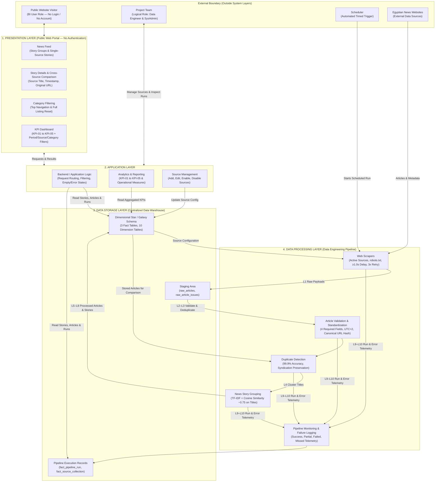
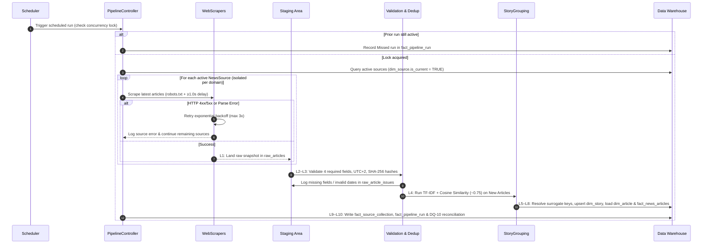

# System Architecture – Layered & High-Level Architecture Design

**Project:** EGYPT-MEDIA-VAULT (Version 1.0 Baseline) | **Phase:** System Analysis & Design

## 1. Overview

This document presents the Layered System Architecture and High-Level Architecture Design for **EGYPT-MEDIA-VAULT**, consolidating the structural blueprint (`Software High-Level Architecture Diagram.jpg`) and architectural specification (`Software_Architecture.pdf`). The design aligns directly with the system's Kimball Fact Constellation Data Warehouse (`raw_articles`, `raw_article_issues`, `3` transaction fact tables, and `10` dimension tables) and the `10`-step incremental ETL pipeline (`L1–L10`), decoupling scheduled batch ingestion from read-only public news browsing and BI analytics (`FR-STO-05`, `FR-WEB-13`).

---

## 2. Architecture Style & Design Rationale

The approved architectural pattern is a **Four-Layer Architecture** with strict adjacent-layer communication and two external boundary elements (**Egyptian News Websites** as external data providers and the **Scheduler** as an automated system trigger):

1. **Workload Isolation:** Separates write-heavy, fault-tolerant scheduled data collection (`UC-01`–`UC-03`) from stateless, read-only public browsing and analytical queries (`UC-04`–`UC-07`, `UC-11`–`UC-13`).
2. **Single Source of Truth (`FR-STO-05`):** Centralizes all historical articles, story clusters, source metadata, and pipeline execution logs inside a single Data Warehouse that serves both the News Portal and the KPI Dashboard without a duplicate operational database.
3. **Localized Change Impact:** Isolates experimental algorithm tuning—such as adjusting the TF-IDF + Cosine Similarity story clustering threshold (`~0.75`, `FR-ST-02`, `BR-07`)—inside the Data Processing Layer without impacting presentation queries.
4. **Fault Containment (`NFR-R01`):** Ensures that HTTP `4xx/5xx` errors, DOM layout changes, or partial run failures never corrupt or take down existing historical records displayed on the public website.

---

## 3. High-Level Architecture Diagram

> **Diagram Reference:** `./diagrams/Software High-Level Architecture Diagram.jpg`

---

## 4. Layer & Component Specifications

### 4.1 Presentation Layer (Public, Unauthenticated)
Accessible immediately to all visitors without login, registration, user accounts, or personalization (`FR-WEB-01`, `FR-WEB-13`, `BR-26`):

| Component | Responsibility | Traceability |
| :--- | :--- | :--- |
| **News Feed** | Main landing page listing identified story groups (including single-source stories) with representative headline, category, publication info, and distinct source count. | `US-11`, `UC-11`, `FR-WEB-02`–`05` |
| **Story Details & Cross-Source Comparison** | Displays one separate article record per covering source with verbatim source title (`BR-25`), publication timestamp (`UTC+2`), and original article URL (`BR-02`). | `US-07`, `US-12`, `UC-12`, `FR-WEB-06`–`07` |
| **Category Filtering** | Provides visible category navigation near the top of the News Feed and restores the full listing on reset. | `US-17`, `UC-11`, `FR-FLT-06`–`08`, `FR-WEB-08`–`10` |
| **KPI Dashboard** | Renders approved analytical metrics (`KPI-01` to `KPI-05`) with consistent period, source, and category filters (`BR-21`). | `US-08`–`10`, `US-13`–`14`, `UC-13`, `FR-WEB-11`–`12` |

### 4.2 Application Layer

| Component | Responsibility | Traceability |
| :--- | :--- | :--- |
| **Backend / Application Logic** | Handles read-only HTTP requests from the Presentation Layer, executes parameterized warehouse queries (`≤ 3.0 s`, `NFR-P03`), applies filters, and returns deterministic empty-result or error states. | `FR-FLT-01`–`05`, `FR-WEB-02`–`12`, `NFR-P03` |
| **Analytics & Reporting** | Computes approved KPIs (`KPI-01` to `KPI-05`) and the `6` supporting operational measures (Data Completeness, Duplicate Rate, Source Share, Pipeline Success Rate, Scraping Failure Rate, Attribution Completeness). | `FR-AN-01`–`11`, `Sec. 9.3` |
| **Source Management** | Enables the **Project Team** to add, edit, enable, and disable configured Egyptian news sources while preserving historical articles and attribution (`BR-15`, `DR-08`). | `US-03`, `US-04`, `UC-10`, `FR-SRC-01`–`06` |

### 4.3 Data Storage Layer (Centralized Data Warehouse)

| Zone / Entity Group | Responsibility | Traceability |
| :--- | :--- | :--- |
| **Isolated Staging Area** | `raw_articles` and `raw_article_issues` store immutable landed snapshots, cryptographic hashes, processing statuses, and record-level validation failure reasons isolated from public queries. | `FR-DQ-03`, `Sec. 9` (DW Design) |
| **Core Analytical Star** | `fact_news_articles` (grain: 1 valid, non-duplicate article) joined to `dim_article` (`1:1`), `dim_source` (SCD Type 2 name), `dim_story`, `dim_category`, `dim_author`, `dim_article_flag`, `dim_date` (role-playing), and `dim_time_of_day`. | `FR-STO-01`–`05`, `DR-01`–`08`, `NFR-SC01` |
| **Execution Monitoring Stars** | `fact_pipeline_run` (grain: 1 scheduled run) and `fact_source_collection` (grain: 1 source attempt per run) joined to `dim_run_status`, `dim_collection_outcome`, `dim_source`, and `dim_date`. | `FR-MON-01`–`06`, `DR-09` |

### 4.4 Data Processing Layer (Data Engineering Pipeline)

| Component | Responsibility | Traceability |
| :--- | :--- | :--- |
| **Web Scrapers** | Fetches articles from active sources (`enabled_status = 'Enabled'`), checks `robots.txt`, enforces `≥ 1.0 s` per-host delay (`NFR-S02`), retries transient errors up to `3` times with exponential backoff, and isolates per-source failures (`NFR-R01`). | `US-01`, `US-04`, `UC-01`, `FR-DC-01`–`08` |
| **Article Validation & Standardization** | Enforces the `4` mandatory fields (`title`, `source`, `link`, `publication_date`), normalizes timestamps to Cairo local time (`UTC+2`, `BR-10`), flags uninterpretable dates as `Invalid` (`BR-12`), and maps missing categories to `"Uncategorized"` (`BR-20`). | `US-05`, `UC-02`, `FR-DQ-01`–`04`, `FR-DQ-08` |
| **Duplicate Detection** | Uses normalized `canonical_url_hash` and temporal windows (`NFR-R02`, `99.9%` accuracy) to deduplicate repeated records while retaining cross-site articles and syndicated repeats (`BR-01`–`04`, `FR-DQ-09`). | `US-06`, `UC-02`, `FR-DQ-05`–`07`, `FR-DQ-09` |
| **News Story Grouping** | Vectorizes standardized titles using TF-IDF and computes Cosine Similarity against active stories (`threshold ≈ 0.75`, `BR-07`), assigning each article to its best-matching story cluster or creating a new one (`BR-08`). | `US-11`, `UC-03`, `FR-ST-01`–`08` |
| **Pipeline Monitoring & Failure Logging** | Records run start/end timestamps, final run outcome (`Success`, `Partial`, `Failed`, `Missed`), per-source counts, failed step, and diagnostic stack traces. | `US-02`, `US-15`–`16`, `UC-08`–`09`, `FR-MON-01`–`06` |

---

## 5. End-to-End Data Flow & Component Interactions

### 5.1 News Collection and Processing Pipeline (`L1–L10`)

### 5.2 Public News Browsing & Cross-Source Comparison (`UC-11`, `UC-12`)
1. A visitor opens the public website without authentication and requests the **News Feed**.
2. **Backend / Application Logic** queries `dim_story` and `fact_news_articles` (optionally filtered by `dim_category.category_name`) and returns story groups—including single-source stories—sorted by recency or distinct source count.
3. When the visitor selects a story, **Backend / Application Logic** joins `fact_news_articles`, `dim_article`, and `dim_source` on `story_key` to display each outlet's verbatim title, standardized `UTC+2` publication timestamp (or `"Time not available"` if invalid), and original source URL.

### 5.3 KPI Dashboard Data Retrieval (`UC-04`–`UC-07`, `UC-13`)
1. A visitor opens the **KPI Dashboard** and applies period (`dim_date`), source (`dim_source`), or category (`dim_category`) filters.
2. **Analytics & Reporting** executes star-schema aggregations over indexed foreign keys (`NFR-P03` `≤ 3.0 s`) to return `KPI-01` (Total Articles Ingested), `KPI-02` (Cross-Source Story Coverage), `KPI-03` (Publication Time Delta), `KPI-04` (Source Publishing Frequency), and `KPI-05` (Category Distribution Share).
3. Sources with zero matching articles in the selected period display `0` via `LEFT JOIN` from `dim_source` (`FR-AN-09`), and filter combinations with no records return a clear empty-result state (`FR-FLT-04`).

---

## 6. Non-Functional & Compliance Enforcement Matrix

| ID | Requirement | Architectural Mechanism |
| :--- | :--- | :--- |
| **NFR-P01** | Scraping Latency (`≤ 2.0 s` / page) | Lightweight asynchronous HTTP client and targeted HTML parser per source configuration. |
| **NFR-P02** | Batch Throughput (`≥ 10,000` articles / `45 min`) | Concurrent domain workers coupled with bulk staging inserts into `raw_articles`. |
| **NFR-P03** | Query Response Time (`≤ 3.0 s`) | Narrow `fact_news_articles` table (`1:1` wide text offloaded to `dim_article`) with composite B-tree indexes on `(ingestion_date_key, source_key)`, `(publication_date_key, source_key)`, and `(story_key, source_key)`. |
| **NFR-R01** | Scraper Resilience | Per-domain `try/except` isolation, `3x` exponential backoff retries, and granular step logging in `fact_source_collection`. |
| **NFR-R02** | Deduplication Accuracy (`99.9%`) | Deterministic URL canonicalization + `UNIQUE` constraint on `dim_article.canonical_url_hash`. |
| **NFR-S01** | Credential Protection | All database URIs and secrets injected strictly via runtime environment variables (`.env` excluded in `.gitignore`). |
| **NFR-S02** | Rate Limiting & Ethics | Mandatory `robots.txt` validation prior to crawl and `≥ 1.0 s` per-host request throttling. |
| **NFR-SC01** | Storage Efficiency (`≥ 2 years`, `500,000+` rows) | Kimball dimensional star schema with integer surrogate keys, reserved `0` members (`PA-33`), and non-destructive SCD Type 2 source history (`DR-08`). |

---

## 7. Requirements & Use Case Traceability

| Architecture Component | Functional Requirements | Use Cases | KPIs / Measures |
| :--- | :--- | :--- | :--- |
| **Web Scrapers & Scheduler** | `FR-DC-01` to `FR-DC-08` | `UC-01` | `KPI-01`, Scraping Failure Rate |
| **Validation, Standardization & Dedup** | `FR-DQ-01` to `FR-DQ-09` | `UC-02` | Data Completeness, Duplicate Rate |
| **News Story Grouping** | `FR-ST-01` to `FR-ST-08` | `UC-03`, `UC-05` | `KPI-02`, `KPI-03` |
| **Centralized Data Warehouse** | `FR-STO-01` to `FR-STO-05` | `UC-02`, `UC-08` | `KPI-01` to `KPI-05` |
| **Analytics & Reporting** | `FR-AN-01` to `FR-AN-11` | `UC-04` to `UC-07`, `UC-13` | `KPI-01` to `KPI-05`, Source Share |
| **Pipeline Monitoring** | `FR-MON-01` to `FR-MON-06` | `UC-08`, `UC-09` | Pipeline Success Rate, Scraping Failure Rate |
| **Source Management** | `FR-SRC-01` to `FR-SRC-06` | `UC-10` | Attribution Completeness |
| **Public Web Portal & Filters** | `FR-FLT-01` to `FR-FLT-08`, `FR-WEB-01` to `FR-WEB-13` | `UC-11`, `UC-12`, `UC-13` | `KPI-01` to `KPI-05` |
