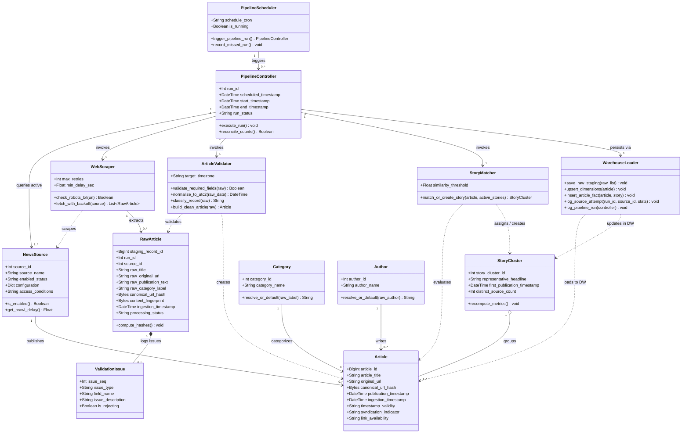
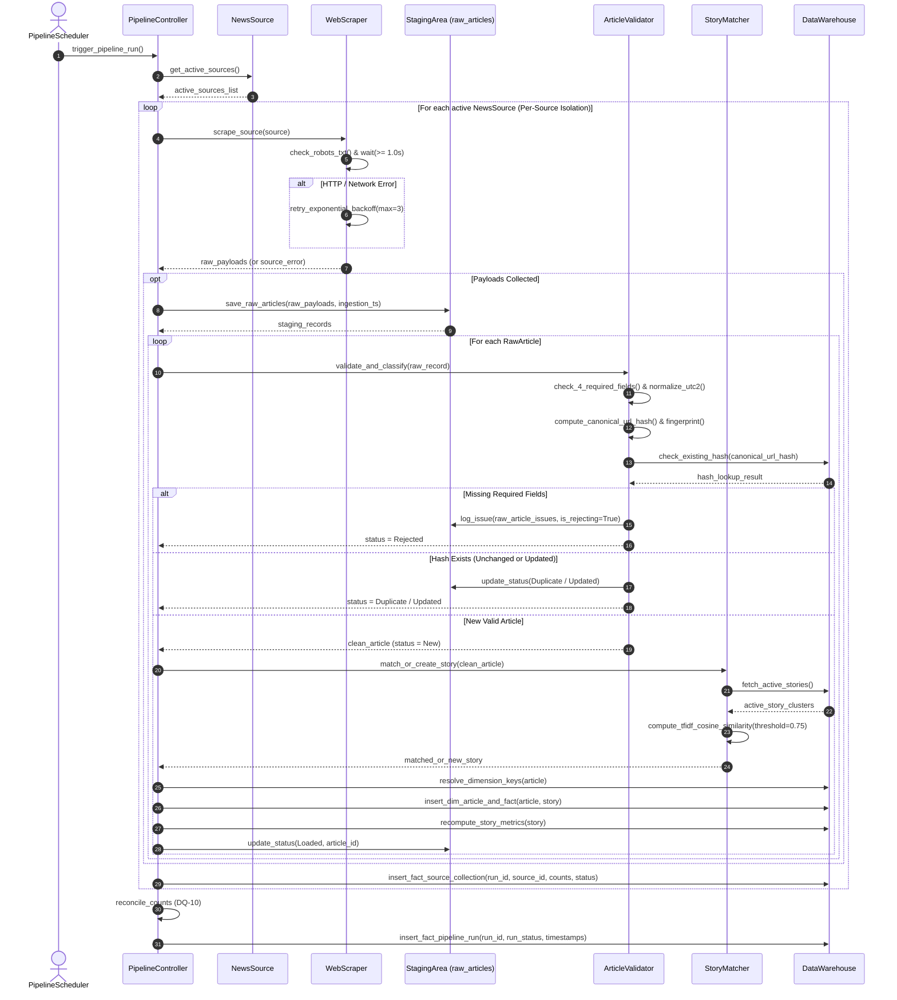

# OOP Design – Class Diagram & Sequence Diagram 1
**Responsible:** Mohamed Abdelmotaleb  **Phase:** System Analysis & Design

## 1. Overview
This document presents the Object-Oriented Programming (OOP) structural and behavioral design for **EGYPT-MEDIA-VAULT**, covering **Deliverable 4 (Class Diagram)** and **Deliverable 5 (Sequence Diagram 1: News Collection & Processing)**. The design aligns directly with the system's Kimball Fact Constellation Data Warehouse (`raw_articles`, `raw_article_issues`, 3 fact tables, and 10 dimensions) and the 10-step incremental ETL pipeline (`L1`–`L10`).

---

## 2. Deliverable 4 – Class Diagram

### 2.1 Class Specifications

| Class Name | Key Attributes | Key Methods | Role & Relationships |
| :--- | :--- | :--- | :--- |
| **`PipelineScheduler`** | `schedule_cron: String`, `is_running: Boolean` | `trigger_pipeline_run()`, `record_missed_run()` | Triggers `0..*` **`PipelineController`** execution runs |
| **`PipelineController`** | `run_id: Int`, `scheduled_timestamp: DateTime`, `start_timestamp: DateTime`, `end_timestamp: DateTime`, `run_status: String` | `execute_run()`, `reconcile_counts()`, `finalize_run()` | Orchestrates **`NewsSource`**, **`WebScraper`**, **`ArticleValidator`**, **`StoryMatcher`**, and **`WarehouseLoader`** |
| **`NewsSource`** | `source_id: Int`, `source_name: String`, `enabled_status: String`, `configuration: Dict`, `access_conditions: String` | `is_enabled()`, `get_crawl_delay()`, `update_config()` | Represents configured Egyptian news portals (`1` source produces `0..*` **`RawArticle`** & **`Article`** records) |
| **`WebScraper`** | `max_retries: Int = 3`, `min_delay_sec: Float = 1.0` | `check_robots_txt()`, `fetch_with_backoff()` | Enforces ethical crawling (`robots.txt`, >= 1.0s delay, up to 3 retries) and outputs **`RawArticle`** objects |
| **`RawArticle`** | `staging_record_id: BigInt`, `run_id: Int`, `source_id: Int`, `raw_title: String`, `raw_original_url: String`, `canonical_url_hash: Hash`, `title_hash: Hash`, `content_fingerprint: Hash`, `ingestion_timestamp: DateTime`, `processing_status: String` | `compute_hashes()`, `mark_status()` | Immutable landed staging payload; owns `0..*` **`ValidationIssue`** records via composition |
| **`ValidationIssue`** | `issue_seq: Int`, `issue_type: String`, `field_name: String`, `issue_description: String`, `is_rejecting: Boolean` | `format_log()` | Records missing required fields or invalid timestamp warnings (`raw_article_issues`) |
| **`ArticleValidator`** | `target_timezone: String = "UTC+2"` | `validate_required_fields()`, `normalize_to_utc2()`, `classify_record()`, `build_clean_article()` | Validates the 4 required fields, normalizes dates to Cairo local time (`UTC+2`), and classifies records (`New`, `Duplicate`, `Updated`, `Rejected`) |
| **`Article`** | `article_id: BigInt`, `article_title: String`, `original_url: String`, `canonical_url_hash: Hash`, `publication_timestamp: DateTime`, `ingestion_timestamp: DateTime`, `timestamp_validity: String`, `syndication_indicator: String`, `link_availability: String` | `is_valid_timestamp()`, `to_fact_record()` | Atomic analytical unit (`dim_article` / `fact_news_articles`); linked to `1` **`NewsSource`**, `1` **`Category`**, `0..1` **`Author`**, and `1` **`StoryCluster`** |
| **`StoryMatcher`** | `similarity_threshold: Float = 0.75` | `vectorize_tfidf()`, `compute_cosine_similarity()`, `match_or_create_story()` | Groups articles into unified stories using TF-IDF + Cosine Similarity on titles (~0.75 threshold) |
| **`StoryCluster`** | `story_cluster_id: Int`, `representative_headline: String`, `first_publication_timestamp: DateTime`, `distinct_source_count: Int` | `add_article()`, `recompute_metrics()` | Parent story entity (`dim_story`) aggregating `1..*` **`Article`** instances |
| **`Category` & `Author`** | `category_id: Int`, `category_name: String` / `author_id: Int`, `author_name: String` | `resolve_or_default()` | Conformed/provisional lookup dimensions defaulting to `"Uncategorized"` and `"Unknown author"` |
| **`WarehouseLoader`** | `db_connection: Connection` | `save_raw_staging()`, `upsert_dimensions()`, `insert_article_fact()`, `log_source_attempt()`, `log_pipeline_run()` | Persists staging records, facts, dimensions, and execution telemetry to the Data Warehouse |

### 2.2 Class Diagram

---

## 3. Deliverable 5 – Sequence Diagram 1: News Collection & Processing

### 3.1 Interaction Flow Summary
1. **Trigger & Active Source Discovery:** `PipelineScheduler` triggers `PipelineController`, which loads active `NewsSource` configurations (`enabled_status = 'Enabled'`).
2. **Per-Source Isolated Scraping:** `WebScraper` checks `robots.txt`, waits >= 1.0s between host requests, and applies up to 3 exponential retries on failure so single-source errors remain isolated.
3. **Immutable Staging Landing (`L1`):** Extracted payloads are written to `raw_articles` with the system `UTC+2` `ingestion_timestamp`.
4. **Validation, Deduplication & Classification (`L2`–`L3`):** `ArticleValidator` enforces the 4 required fields (`title`, `source`, `link`, `publication date`), converts timestamps to `UTC+2`, hashes URLs/content, records issues in `raw_article_issues`, and classifies rows as `Rejected`, `Duplicate`, `Updated`, or `New`.
5. **Story Clustering (`L4` & `L6`):** `StoryMatcher` computes TF-IDF + Cosine Similarity (~0.75) on titles for `New` articles to assign an existing `StoryCluster` or create a new one.
6. **Warehouse Load & Execution Logging (`L5`, `L7`–`L10`):** `WarehouseLoader` resolves surrogate keys, inserts `dim_article` and `fact_news_articles`, refreshes `dim_story` derived metrics, logs per-source and run-level outcomes (`fact_source_collection`, `fact_pipeline_run`), and runs `DQ-10` reconciliation.

### 3.2 Sequence Diagram 1

